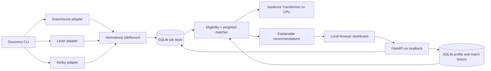
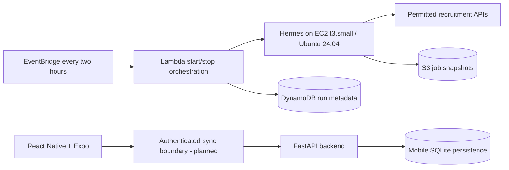

# CareerPilot AI architecture

## Implemented in this repository

The API defaults both SQLite repositories to `~/.jobcare/jobcare.db`. `JOBCARE_JOB_DB` and `JOBCARE_PROFILE_DB` can point them at separate files. The CLI and API now use the same environment-variable defaults so a local demo can seed and read the same stores.

Candidate profile rows track `reviewed_at`; profile creation/import does not approve the record. A user must explicitly approve it through `POST /api/profile/review`. Edits clear that timestamp. Recommendation calls reject unreviewed profiles.

Job discovery adapters use the existing public Greenhouse, Lever, and Ashby endpoints. The adapters normalize records into `JobRecord` and the existing storage layer keeps `(provider, original_job_id)` unique. Discovery still runs through the CLI; the API ranks already persisted jobs.

Deterministic matching uses skill overlap (0.40), role relevance (0.20), experience (0.20), location (0.10), and education (0.10). If the local `all-MiniLM-L6-v2` Sentence Transformer loads, the result is `0.70 × deterministic + 0.30 × cosine similarity` by default. The semantic weight is request-configurable. Match history stores scores, explanations, eligibility result, model identifier, and algorithm version. Missing model/dependency errors fall back to deterministic-only output.

## Planned original architecture

The dashed/future boundary above describes the agreed target, not deployed infrastructure. Hermes, AWS orchestration and storage, Expo Router, mobile-side SQLite, authentication, and application tracking are **planned**. This repository has not provisioned AWS resources. Job applications remain manual.

## Trust boundaries

- The demonstration API binds to `127.0.0.1` and rejects non-loopback clients by default. It has no identity or authorization layer and is not safe to expose publicly.
- The mobile app must never receive model-provider keys or AWS credentials. Any future mobile sync API needs authentication and per-candidate authorization before remote deployment.
- Job fields not supplied by the source stay unknown; eligibility does not infer a country or candidate experience duration from incomplete text.
- Resume files and local SQLite data are excluded from Git. Do not put personal profiles or credentials in fixtures or logs.
